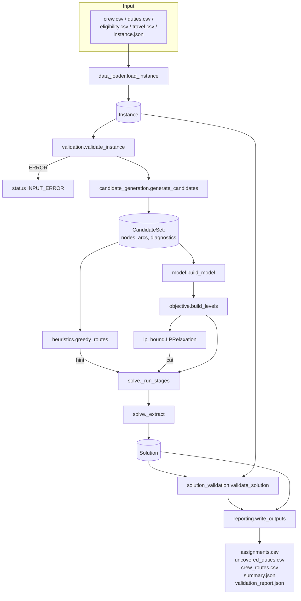
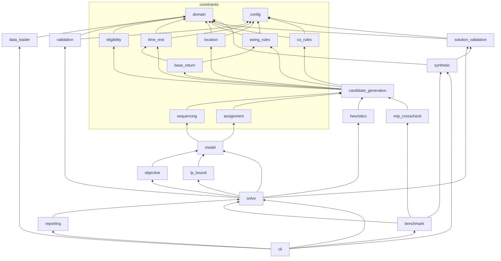

# Codebase Guide

A top-down tour of the repository for someone who knows Python and basic
optimisation, but has not seen this code before. Read it with the code open.

## 1. What the project does

It assigns available **Relief and Excess** railway crew to **uncovered duties**
over a multi-day horizon (OptiFlux scenario: Howrah, Yajpur, Nellore). The
goal is to cover as much demand as possible without breaking eligibility,
swing, start-time, rest (11 h / 23 h), location and base-return rules.
Duties left uncovered are reported with a reason. The optimiser is Google
OR-Tools **CP-SAT**, and every solution is re-checked by an **independent
validator**.

## 2. Repository layout

```text
Railway-Crew-Rostering-Optimization/
├── README.md                         entry point, quick start, links
├── Optiflux_crew_rostering_problem.md  problem specification (primary source, unchanged)
├── railway_crew_v1.ipynb             V1 Colab notebook (unchanged, legacy)
├── rostering_v1_sheets.ipynb         V1 Drive notebook (unchanged, legacy)
├── Papers/tabu_search_approach.pdf   Yu et al. 2025 (unchanged)
├── Progress/CP_SAT_vs_MIP_Solvers.pdf  solver rationale note (unchanged)
├── pyproject.toml, requirements.txt  dependencies (core: ortools only)
├── .github/workflows/tests.yml       CI: lint + pytest + CLI smoke test
├── docs/                             all documentation (this file included)
├── src/railway_rostering/            the package
│   ├── __init__.py                   public API
│   ├── __main__.py                   `python -m railway_rostering`
│   ├── domain.py                     dataclasses: Crew, Duty, Instance, ...
│   ├── config.py                     ModelConfig (rules) + SolverConfig
│   ├── data_loader.py                CSV -> Instance (+ legacy V1), Instance -> CSV
│   ├── validation.py                 input consistency checks
│   ├── constraints/                  operational rules
│   │   ├── eligibility.py            who may do which activity
│   │   ├── time_rest.py              DAY/NIGHT, 11 h / 23 h rest
│   │   ├── location.py               continuity + optional positioning
│   │   ├── swing_rules.py            swing calendar, lift-up/layback, persistence
│   │   ├── base_return.py            when the crew member must pass through base
│   │   ├── co_rules.py               CO interface (disabled)
│   │   ├── sequencing.py             CP-SAT AddCircuit per crew member
│   │   └── assignment.py             CP-SAT demand / coverage / fixed / caps
│   ├── candidate_generation.py       nodes + arcs per crew member, pruning, diagnostics
│   ├── model.py                      builds the CP-SAT model
│   ├── objective.py                  objective levels, weighted mode
│   ├── lp_bound.py                   GLOP relaxation -> valid bound cut
│   ├── heuristics.py                 greedy roster (baseline + hint)
│   ├── solve.py                      the pipeline, lexicographic stages, extraction
│   ├── solution_validation.py        INDEPENDENT validator
│   ├── reporting.py                  output CSV/JSON, rule-status table
│   ├── mip_crosscheck.py             flow MIP on the same arcs (SCIP/HiGHS)
│   ├── synthetic.py                  reproducible synthetic generator + presets
│   ├── benchmark.py                  benchmark runner
│   └── cli.py                        command-line interface
├── scripts/                          thin wrappers runnable from a fresh clone
│   ├── run_example.py
│   ├── generate_synthetic_instance.py
│   └── benchmark.py
├── data/
│   ├── sample/v1_toy/                V1 notebook data (legacy CSV format)
│   ├── sample/briefing_abc/          ABC example from the briefing
│   └── generated/{small,medium,tight,large,xlarge}/  synthetic presets
├── notebooks/
│   ├── exploratory_analysis.ipynb    look at an instance
│   └── solution_visualization.ipynb  Gantt-style view of a solution
└── tests/                            pytest suite (171 tests)
```

## 3. Data flow



## 4. How data enters the system — `data_loader.py`

`load_instance(directory)` (or explicit `crew_path=`, `duties_path=`, ...)
reads the CSVs with Python's `csv` module (no pandas dependency) and builds
an `Instance`:

* Header names are stripped of whitespace *before* the required columns are
  checked (this fixes a bug in the V1 notebook). V1 column names are mapped:
  `person_id → crew_id`, `id → duty_id`, `eligible → eligible_crew`.
* Every row is parsed into an immutable `Crew` or `Duty` (`domain.py`). Bad
  rows are collected, not raised one by one. A single `DataError` lists every
  problem (invalid timestamps, duplicate ids, `end ≤ start`, demand < 1,
  missing columns).
* A duty's `end` comes from the `end` column, else `duration_hours`, else
  12 h. A 17:00 duty therefore ends 05:00 the next day.
* The horizon comes from `instance.json`, or is inferred from duty dates.

`write_instance` writes the canonical schema back (the generator uses it). A
round-trip test checks load(write(x)) = x.

## 5. How the input is validated — `validation.py`

`validate_instance` returns a list of `Issue(severity, code, message)`:

* **ERROR** (the run stops with `INPUT_ERROR`): unknown crew in an eligible list
  or in `assigned_crew`, overlapping existing duties for one crew member,
  bad horizon, prior duty after the horizon.
* **WARNING** (the run continues): no crew type, no base (base rules skipped
  for that crew member), no rostered time, no swing calendar, a duty with no
  eligibility information, a duty outside the horizon, an unknown
  `co_location`, and so on.

Warnings appear in `summary.json → input_issues`, so a planner can see which
rules were not applied to whom.

## 6. How candidate assignments are generated — `candidate_generation.py`

This is the most important module to understand. For each crew member it
builds a small directed graph:

* **Nodes** = duties this crew member could do at all. Node filters, in order
  (each filter counts survivors in `DutyDiagnostics`):
  1. eligibility (`constraints/eligibility.py`)
  2. availability: leave dates, swing off days (`swing_rules.availability_reason`)
  3. allowed start time: lift-up/layback, already-changed time (`swing_rules.time_change_reason`)
  4. CO hook (`co_rules.candidate_allowed`, allows all)
* **Arcs** = "duty `v` may come *directly after* `u`". `_connect(crew, tail,
  head)` checks, in order: daily cap, persistence, base requirement →
  location connection → rest + travel → CO hook. Start arcs use a virtual
  tail (`_source_endpoint`: initial location, prior duty). End arcs use a
  virtual head (`_sink_endpoint`: next commitment, or "must be at base if
  the swing ends in the horizon").
* **Pruning**: nodes not on any SOURCE → SINK path are removed by a forward
  and a backward sweep over the time-ordered DAG.
* **Diagnostics**: per duty, the number of crew members considered, eligible,
  available, time-compatible and reachable. `structural_reason()` turns these
  into a reason code (`NO_ELIGIBLE_CREW`, `NO_AVAILABLE_CREW`,
  `NO_TIME_COMPATIBLE_CREW`, `NO_FEASIBLE_SEQUENCE`,
  `INSUFFICIENT_CANDIDATES`).

Existing (fixed) assignments are always kept as nodes. If one is unreachable,
`issues` records it and the model will be INFEASIBLE.

All times inside the candidate set are **integer minutes since the horizon
start**.

## 7. How the optimisation model is constructed — `model.py`, `constraints/`

`build_model(cands)` creates:

1. `x[c, i]` for every node (crew member `c`, duty `i`);
2. for each crew member, `sequencing.add_crew_circuit`: an `empty[c]` literal,
   one literal per arc, and the `AddCircuit` with self-loops `¬x` (see
   `problem_formulation.md` §6.1 for why this is exactly "one chronological
   path"), plus redundant flow rows;
3. `assignment.add_demand_constraints`: staffing bounds and the coverage
   expressions;
4. `assignment.add_fixed_assignments`: `x = 1` for existing assignments;
5. `assignment.add_daily_cap`: per crew member and date (cap > 1 case);
6. `assignment.add_redundant_cliques`: valid strengthening rows.

`RosteringModel` keeps the variable dictionaries so that later steps (the
objective, hints, the LP and extraction) can find the variables.

## 8. How the solver finds a solution — `objective.py`, `lp_bound.py`, `heuristics.py`, `solve.py`

`solve_instance(instance, model_config, solver_config)` is the single entry
point:

1. Input validation, then candidate generation.
2. `greedy_routes(cands)` builds a legal roster quickly. Its coverage is
   reported as `greedy_baseline` and it is passed to CP-SAT as a complete
   hint.
3. `_run_stages` builds the model and the objective levels, then for each
   non-trivial level:
   * solves the **LP relaxation** (GLOP) of that level and adds `level ≤
     ⌊LP⌋` as a cut, if it does not exclude a known feasible roster
     (`lp_bound.py` explains why the cut is valid);
   * sets the objective and runs CP-SAT with `time_limit_seconds`,
     `num_workers` and `random_seed`;
   * records status, value and bound. The bound reported is the tighter of
     CP-SAT's own and the LP's;
   * fixes the level (`level ≥ value`) and hints the next stage with this
     solution.
4. If a cut ever made a stage INFEASIBLE (a numerical problem only), the solve
   is repeated without cuts.
5. The overall status is OPTIMAL only if every stage was OPTIMAL (see
   `problem_formulation.md` §8).

## 9. How assignments are extracted — `solve._extract`

* `assignments` = every `x[c, i]` that is true (marked `existing` if it was in
  the input roster).
* `routes[c]` = the duties in circuit order, found by following the true
  arcs from SOURCE to SINK.
* `positioning` = the legs on the used arcs, with the base-return reason.
* A consistency check raises an error if the route and the true `x` values
  disagree. That would indicate an encoding bug.

## 10. How the independent validator checks the solution — `solution_validation.py`

`validate_solution(instance, config, assignments)` uses only the raw data,
the configuration and the list of (crew, duty) pairs. **It does not import
candidate generation, the constraint modules, the model or the objective**
(a test checks this). It re-implements shift classification, swing
arithmetic, rest, location and base rules in its own code, sorts each crew
member's duties by time itself, and checks:

ids and duplicates · demand · existing assignments · eligibility · leave ·
off days · start-time offsets · persistence · all-pairs overlap · daily cap ·
consecutive rest including transitions and travel · location continuity from
the initial location · base return between swings, on transitions and at
swing end · rest and location before the next commitment · coverage
recomputation (and `COVERAGE_MISMATCH` against the solver's claim).

The result is a `ValidationReport` (`passed`, the violations by rule, the
recomputed coverage, and the list of rules checked).

## 11. How results are written — `reporting.py`

`write_outputs(result, output_dir)` writes:

| File | Content |
|---|---|
| `assignments.csv` | crew_id, crew_type, sequence, duty_id, activity, start, end, locations, shift_type, rostered time, start_offset_minutes, assignment_type (new/existing), base |
| `uncovered_duties.csv` | every duty with uncovered demand: units, `reason_code` + text, filter counts (`n_eligible`, `n_available`, `n_time_ok`, `n_feasible_candidates`) |
| `crew_routes.csv` | one row per working crew member: route `D1 > D2 > ...`, final location, ends_at_base |
| `positioning.csv` | positioning legs (only when positioning is enabled) |
| `summary.json` | status per stage, objective values, bounds, gap, coverage, greedy baseline, timings, model size, LP bounds, input issues, **rule status table**, full configurations |
| `validation_report.json` | the independent validator's report |

`NOT_SELECTED` in `uncovered_duties.csv` means feasible candidates existed but
the optimiser used them elsewhere. Every other reason code means the duty
could not be covered by anyone under the enabled rules.

## 12. Module dependencies



(Arrows point from a module to what it imports.) `solution_validation`
depends only on `domain` and `config`. That is what makes it independent.

## 13. File-by-file reference

### `domain.py`
Frozen dataclasses `Crew`, `Duty`, `TravelLink`; mutable `Instance` (sorts
duties by start, `duty(id)` lookup, `total_open_demand`); `Assignment`,
`Solution`; enums `CrewType` (RELIEF, EXCESS, UNSPECIFIED for legacy files)
and `ShiftType`. Helpers `minutes_of_day` and `circular_offset_minutes`
(e.g. 23:30 → 00:30 is +60). No logic beyond data.

### `config.py`
`ModelConfig`: every rule switch, with a comment saying whether the default
is specified or assumed. `validate()` rejects unknown modes. `SolverConfig`:
time limit per stage, workers, seed, logging, greedy hint, LP cut.
`load_configs(json)` accepts `{"model": {...}, "solver": {...}}`.

### `data_loader.py`
See §4. Main functions: `load_instance`, `write_instance`,
`parse_crew_rows`, `parse_duty_rows`, `parse_eligibility_rows`,
`parse_travel_rows`; exception `DataError`.

### `validation.py`
See §5. `validate_instance`, `has_errors`, `Issue`.

### `constraints/eligibility.py`
`ineligibility_reason(crew, duty, instance)` returns `None` or a reason.
Exact activity match: "Howrah Mainline" ≠ "Howrah Mainline CO".

### `constraints/time_rest.py`
`classify_start`, `shift_type_of` (explicit column wins), `is_transition`,
`required_rest_minutes` (23 h only on a DAY↔NIGHT change and only if
enabled), `minimum_possible_rest_minutes` (used for the cliques).

### `constraints/location.py`
`Leg`, `Connection`, `direct_connection` (same place, or one positioning link
when enabled), `connection_via` (through the base).

### `constraints/swing_rules.py`
Swing arithmetic (`work_pattern`, `swing_day`, `swing_last_work_date`,
`current_swing_index`), `availability_reason`, `policy_for`,
`reference_time`, `time_change_reason` (node rule) and `persistence_allows`
(arc rule). The docstring explains the conflict between the briefing's text
and its examples.

### `constraints/base_return.py`
`base_required_between` (swing change or shift transition) and
`base_required_after_last_duty` (swing ends inside the horizon, or the
horizon-end option).

### `constraints/co_rules.py`
Hook functions that currently allow everything, and a `STATUS` dictionary
printed in the summary. Explains what is and is not implemented for CO.

### `constraints/sequencing.py`
`add_crew_circuit`: the circuit, the `empty` literal, redundant implications
and the optional flow rows.

### `constraints/assignment.py`
`add_demand_constraints` (returns the coverage expressions),
`add_fixed_assignments`, `add_daily_cap`, `add_redundant_cliques`.

### `candidate_generation.py`
See §6. `generate_candidates` → `CandidateSet(crews, diagnostics, issues,
stats)`; `Node`, `Arc`, `CrewCandidates`, `DutyDiagnostics`; reason codes and
`REASON_TEXT`.

### `model.py`
`build_model(cands)` → `RosteringModel` (variables and stats).

### `objective.py`
`build_levels(rm)` → a list of `LevelExpr` (terms, constant, sense, upper
bound, trivial flag). `weighted_objective(levels)`. Priority weights come
from `ModelConfig.priority_weights`.

### `lp_bound.py`
`LPRelaxation(rm)` builds the GLOP model with the same variables (continuous)
and flow rows. `bound(terms, constant, maximise)` solves it, and
`add_level_constraint` fixes earlier stages. `integral_cut_value` rounds the
bound with a 1e-6 tolerance.

### `heuristics.py`
`greedy_routes(cands)`: duties in time order, each assigned to the feasible
crew member with the fewest remaining options; it always keeps routes
closable.

### `solve.py`
`solve_instance` (the pipeline), `_run_stages` (lexicographic loop, LP cuts,
hints), `_extract`, `RunResult`.

### `solution_validation.py`
See §10. `validate_solution`, `ValidationReport`, `Violation`, rule-name
constants such as `OVERLAP` and `INSUFFICIENT_REST`.

### `reporting.py`
See §11. `write_outputs`, `build_summary`, `rule_status`, `console_summary`,
and the row builders `assignment_rows`, `uncovered_rows`, `route_rows`.

### `mip_crosscheck.py`
`solve_flow_mip(cands, "SCIP")`: the unit-flow MIP on the same arcs. Used in
tests and benchmarks to check the circuit encoding.

### `synthetic.py`
`SyntheticConfig`, `PRESETS`, `ACTIVITY_CATALOG`, `QUALIFICATION_PROFILES`,
`generate_instance`. See `dataset_design.md`.

### `benchmark.py`
`run_benchmarks(presets, variants, ...)` writes `results.csv`, `.json` and `.md`.
Variants: `default`, `no_lp_bound`, `no_cliques`, `no_hint`, `positioning`,
`window_only`, `relaxed`.

### `cli.py`
Sub-commands `generate`, `solve`, `validate`, `benchmark`. Exit codes: 0 =
success, 2 = input error, 3 = validation failed. `--set key=value` overrides
any `ModelConfig` field (the value is parsed as JSON).

## 14. Walk-through: following one duty

Take `D02` of `briefing_abc` (2 Nov 17:00, Yajpur → Howrah, Yajpur Mainline):

1. `data_loader` creates `Duty(D02, end=3 Nov 05:00, demand=1)`.
2. `candidate_generation`: ABC is qualified for "Yajpur Mainline" ✓; 2 Nov is
   day 2 of a 14-day swing ✓; Relief may start at any time, and 17:00 equals
   the rostered time ✓. So `Node(D02)` exists for ABC.
3. Arcs: `D01 → D02` exists (D01 ends 2 Nov 05:00 at Yajpur, which is D02's
   start; NIGHT→NIGHT needs 11 h, and there are 12 h). There is no `SOURCE →
   D02`, because ABC starts in Howrah.
4. `model`: `x[ABC, D02]` and the arc literal `arc[ABC, D01->D02]` are added
   to ABC's circuit.
5. `solve`: the coverage stage finds 6 (the LP bound is also 6, so the cut
   proves optimality at once).
6. `_extract`: the route `D01 > D02 > D03 > D05 > D06 > D07`.
7. `validate_solution`: re-derives everything above independently → passed.
8. `reporting`: `assignments.csv` row with `sequence=2`, `shift_type=NIGHT`,
   `start_offset_minutes=0`.

## 15. Glossary

| Term | Meaning here |
|---|---|
| Duty | A unit of work with start/end time and location and a demand |
| Open demand | Demand minus crew already assigned in the input |
| Candidate | A (crew member, duty) pair that passed every node rule |
| Arc | "Duty v may directly follow duty u" for one crew member |
| Swing | A block of consecutive working days (14 for Relief, 6 for Excess, by default) |
| Lift-up / layback | Excess start time one hour earlier / later |
| Transition | DAY↔NIGHT change between consecutive duties (23 h rest) |
| Positioning | Travel without working (off by default) |
| Lexicographic | Optimise level 1, fix it, then optimise level 2, and so on |
| OPTIMAL / FEASIBLE | Proven best / best found, not proven |
