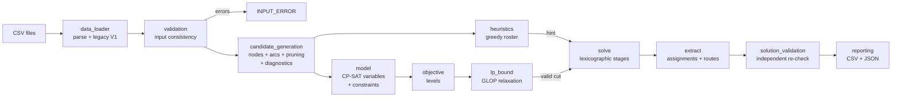

# Model Architecture

How the optimisation is built, why it is built that way, and what was tried
and rejected. The exact equations are in `problem_formulation.md`.

## 1. Pipeline

## 2. Core design decision: "rules as graph, choices as circuit"

The OptiFlux difficulty is **sequencing**. A duty can be feasible on its own
yet block later duties, because each duty moves the crew member and starts a
rest clock. The model therefore gives each crew member a **path through a
time-ordered graph of their own candidate duties**, rather than matching
duties to people independently.

Responsibilities are split in two:

1. **Candidate generation (Python).** Every rule that depends on one
   crew–duty pair or on two consecutive duties is evaluated *before* solving
   and becomes the existence or absence of a node or arc: eligibility,
   availability, swing days, lift-up/layback, persistence, rest (11 h / 23 h),
   location, positioning, base return, daily cap of 1, and boundary
   conditions.
2. **CP-SAT.** It chooses the paths (`AddCircuit`, one per crew member) and
   enforces what links paths together or is not pairwise: demand per duty,
   existing assignments, daily cap > 1. It also handles the objective.

Why this split:

* **Correctness is easier to argue.** Each pairwise rule is a small pure
  function with its own unit tests. Section 6.1 of `problem_formulation.md`
  proves that checking consecutive pairs is enough.
* **The model stays small.** Infeasible pairs and arcs never become
  variables. At the `large` preset (1,000 crew, 300 duties, 50 eligible per
  duty) the model has 2,409 assignment literals and 6,769 arc literals. The
  V1 dense formulation would have about 1000 × (300² + 2·300) ≈ 90 million arc
  literals.
* **Adding a pairwise rule is local.** Add a predicate in `constraints/`, call
  it from `_connect`, mirror it in the validator, and add tests. The solver
  model is unchanged.
* **Uncovered duties can be explained.** The filters are applied in a fixed
  order, so the first filter that eliminates every crew member is the reason.

Trade-off: rules that are *not* pairwise along a path (e.g. "at most N
working days in a row", "maximum hours per swing") cannot be pushed into the
arcs. They would need per-crew counters in CP-SAT. None is specified in the
briefing.

## 3. Why `AddCircuit` (and its alternatives)

| Option | Verdict |
|---|---|
| **`AddCircuit` per crew member** (chosen, inherited from V1) | Native CP-SAT global constraint. Encodes "these chosen duties form one ordered chain" exactly, with strong propagation. Reused from V1 after review (`initial_assessment.md` §2.1). |
| Flow conservation only (`in(i) = x = out(i)`) | Also exact on a DAG. Tested in CP-SAT on `large`: **worse** (bound stuck at 369 after 60 s vs. OPTIMAL in ~40 s with the circuit). Kept as optional *redundant* rows (`add_flow_linearization`) and as the MIP cross-check. |
| Pairwise conflict constraints `x_ci + x_cj ≤ 1` (no ordering) | Cannot express location continuity: whether `i` then `j` is legal depends on which duties lie between them. Rejected. |
| Time-indexed model (crew × hour) | Very large (1,000 × 336 hours), and location still needs sequencing. Rejected. |
| Set partitioning / column generation (enumerate legal rosters, choose one per crew) | The standard industrial end state (CP-SAT note §"Where MIP still wins"). Not needed at the measured scale; the same arc rules would become the pricing subproblem's legality checks. Future work. |
| Tabu search (Yu et al. 2025, in `Papers/`) | Fast, but gives no bound. The greedy heuristic plays the "fast first roster" role here, and CP-SAT supplies the bound. |

## 4. Constraint modules

| Module | Kind | Rule family |
|---|---|---|
| `constraints/eligibility.py` | predicate | activity table ∩ per-duty list |
| `constraints/time_rest.py` | predicate | shift type, transition detection, required rest |
| `constraints/location.py` | predicate | direct/via-base connections, positioning legs |
| `constraints/swing_rules.py` | predicate | swing calendar, availability, allowed offsets, persistence |
| `constraints/base_return.py` | predicate | when the crew member must pass through base |
| `constraints/co_rules.py` | predicate (disabled) | CO hook points |
| `constraints/sequencing.py` | CP-SAT | `AddCircuit` + optional flow rows |
| `constraints/assignment.py` | CP-SAT | demand, coverage, fixed assignments, daily cap, cliques |

`candidate_generation._connect` is the single place where arc predicates are
combined, so every arc type (start, between duties, end) uses the same rules.

## 5. Objective hierarchy

The default `objective_levels` is `["coverage", "priority", "positioning",
"time_changes", "roster_changes"]`, solved **lexicographically**:

1. Maximise covered demand (the briefing's stated goal).
2. Among maximum-coverage rosters, prefer priority-weighted coverage. Only
   Howrah Mainline has a stated priority, so this is a tie-breaker. Putting
   `priority` first makes priority strictly dominant (tested).
3. Minimise positioning cost (only when positioning is enabled).
4. Minimise duties worked at a non-rostered time. This keeps rosters close to
   plan; an assumption, but harmless because it is lexicographically last.
5. Minimise moved existing assignments (reassignable mode only).

Levels that cannot change the ranking are skipped automatically. A weighted
single-objective mode exists (`objective_mode = "weighted"`) and is tested to
give the same answers on small cases. Lexicographic is the default because
each stage's status (OPTIMAL vs FEASIBLE) can be reported separately, and
big-M style weights grow quickly with instance size.

## 6. Performance considerations and what was measured

All numbers come from this environment (4 vCPU, OR-Tools 9.15, Python 3.13).
Full tables are in `validation_report.md`.

1. **Sparse candidates.** Model size scales with Σ_c |I_c|², not P·N².
   `large`: the duty lists name 48.95 crew members per duty on average, but
   after eligibility, swing days, start-time rules and reachability pruning
   only **8.4 feasible candidates per duty** remain (maximum 22). 633 of the
   1,000 crew members have at least one candidate, with at most 22 each.
2. **Greedy hint.** The greedy roster is always complete and legal (it uses
   the same arcs), and CP-SAT reports it as "complete hint". On `large` it
   gives 273 units at t = 0.7 s. CP-SAT then improves to the optimum 296 within
   1.5 s.
3. **Proving optimality was the bottleneck.** Without help, CP-SAT spent
   ~40 s closing its bound on `large` (from 312 to 296), and the priority
   stage hit the 60 s limit (FEASIBLE, bound 444 vs 424). Things tried:
   * redundant flow rows — no measurable effect (38.5 s);
   * `add_lp_constraints_lazily = False` — no improvement (33–42 s);
   * `linearization_level = 2` — slower (45 s);
   * flow-only formulation — much worse (bound 369 at 60 s);
   * the **LP relaxation of the flow formulation equals the integer optimum
     (296.0)** on `large`, and SCIP solves the flow MIP in 0.6 s.
   Hence the **LP-bound cut** (`lp_bound.py`): solve the GLOP relaxation per
   stage (≈0.2 s) and add `objective ≤ ⌊LP⌋`. It is valid because the LP is a
   relaxation of the CP-SAT model. On `large` all three stages are proven
   optimal in about 10 s instead of 154 s with one stage unproven. On `tight`
   the LP bound (141.7) is not integral-tight, and CP-SAT still needs ~30 s
   to prove 141. Tests check that the cut never changes the optimum.
4. **Redundant cliques** help the LP slightly (39.5 s vs 41.4 s on `large`
   without the LP cut). They are cheap, so they are kept.
5. **Time limit semantics.** `time_limit_seconds` applies *per stage*, so a
   run with three active levels can take up to three times the limit.
6. **Skewed eligibility.** Arcs grow quadratically in a crew member's
   candidate count. The `xlarge` preset (100 eligible per duty) tests this.

## 7. Independent checks

| Check | What it validates | Where |
|---|---|---|
| Independent validator | every returned solution, against the raw data and the enabled rules | `solution_validation.py`, run on every solve |
| Brute force | candidate generation + circuit + objective on random tiny instances (40 in CI; 300 run once) | `tests/test_known_optimal.py` |
| Flow MIP (SCIP) | the circuit encoding, on the same arcs | `mip_crosscheck.py`, `tests/test_end_to_end.py`, benchmarks |
| Hand-checkable cases | each rule at its exact boundary | `tests/test_*.py` |
| Route/x consistency | the circuit arcs and `x` describe the same duties | `solve.py::_extract` (raises on mismatch) |

## 8. Extension points

* **New pairwise rule**: predicate in `constraints/`, call in `_connect` or in
  the node filter, mirror in `solution_validation.py`, add tests.
* **CO rules**: implement a mode in `co_rules.py` (`candidate_allowed`,
  `arc_allowed`) and the matching validator check.
* **Non-pairwise rule** (e.g. maximum consecutive working days): add per-crew,
  per-day Booleans `work[c, d] = OR(x_ci : d_i = d)` in `assignment.py`, then
  a sliding-window sum.
* **New objective**: add a level in `objective.py::build_levels` and to
  `OBJECTIVE_LEVELS`.
* **Scale beyond CP-SAT**: reuse the candidate arcs as the pricing graph of a
  column-generation model (`mip_crosscheck.py` already builds the flow MIP).
